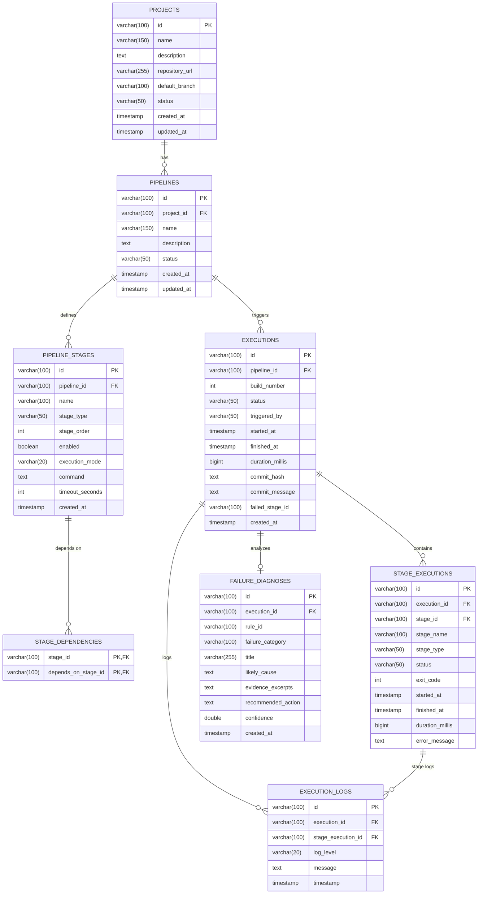

# DevOpsHub Database Design & Schema Architecture

## 1. Relational Database Design
DevOpsHub uses a normalized relational data model designed for MySQL 8.0 (compatible with ANSI SQL). It maintains referential integrity via foreign key constraints, supports cascading deletes where appropriate, and uses dedicated indexes for execution queries.

### Entity Relationship Diagram (ERD)

---

## 2. Table Specifications

### 2.1 `projects`
Stores high-level workspace projects.
- `id`: `VARCHAR(100) PRIMARY KEY`
- `name`: `VARCHAR(150) NOT NULL`
- `description`: `TEXT`
- `repository_url`: `VARCHAR(255) NOT NULL`
- `default_branch`: `VARCHAR(100) DEFAULT 'main'`
- `status`: `VARCHAR(50) DEFAULT 'ACTIVE'`

### 2.2 `pipelines`
Defines automated workflows belonging to a project.
- `id`: `VARCHAR(100) PRIMARY KEY`
- `project_id`: Foreign key referencing `projects(id)` with `ON DELETE CASCADE`.
- `name`: Workflow title.

### 2.3 `pipeline_stages`
Granular units of work within a pipeline (e.g., checkout, build, test, deploy).
- `stage_type`: `CHECKOUT`, `BUILD`, `TEST`, `SECURITY`, `PACKAGE`, `DEPLOY`, `MONITOR`.
- `execution_mode`: `SEQUENTIAL` or `PARALLEL`.
- `command`: Approved command or script string executed by `ProcessExecutor`.

### 2.4 `stage_dependencies`
Represents the Directed Acyclic Graph (DAG) for stage prerequisites.
- Composite primary key: `(stage_id, depends_on_stage_id)`.
- Validated at runtime by `PipelineValidator` to prevent dependency cycles.

### 2.5 `executions`
Records of pipeline run instances.
- Tracks `build_number` monotonically.
- Records top-level status (`QUEUED`, `RUNNING`, `SUCCESS`, `FAILED`, `CANCELLED`).
- Stores timestamps and calculated duration.

### 2.6 `stage_executions`
Execution outcome for each stage during a run.
- Stores process `exit_code` (0 for success, non-zero for failures).
- Records `started_at` and `finished_at`.

### 2.7 `execution_logs`
Fine-grained stdout/stderr output lines for an execution.
- Retains log level (`INFO`, `WARN`, `ERROR`, `DEBUG`).
- Indexed on `(execution_id, timestamp)` for high-performance log querying.

### 2.8 `failure_diagnoses`
Results generated by the rule-based failure intelligence engine.
- Stores `rule_id`, `failure_category`, human-readable `title`, `likely_cause`, `evidence_excerpts`, and `recommended_action`.
- Linked 1-to-1 with the corresponding failed execution.

---

## 3. Data Integrity & Migration Strategy
- Migrations are versioned SQL scripts located in `database/migrations/`:
  - `V1__initial_schema.sql`: Complete DDL creating tables, primary keys, and foreign keys.
  - `V2__sample_seed_data.sql`: Realistic seed data matching presentation workflows (including Build #184 failure).
- Automated execution via `DatabaseConfig.runMigrations()` on startup ensures zero-downtime, automated setup on clean environments.
