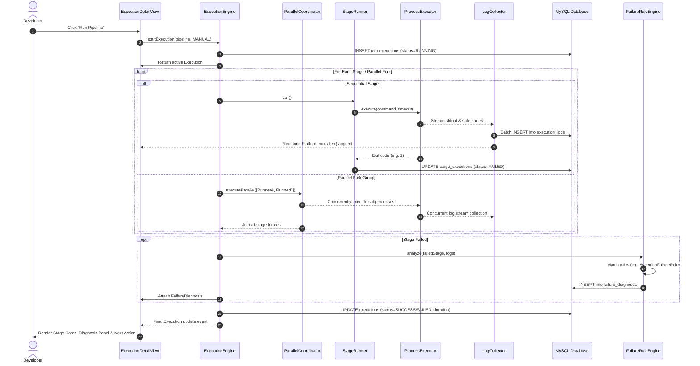

# DevOpsHub — End-to-End Data Flow Architecture

This document maps the flow of data through DevOpsHub during pipeline configuration, execution, logging, intelligence analysis, and visualization.

---

## 1. End-to-End Execution & Diagnostic Data Flow

---

## 2. Log Data Flow Pipeline

1. **Generation:** Subprocesses launched by `ProcessExecutor` emit raw character bytes to their stdout and stderr output streams.
2. **Concurrent Capture:** Two dedicated reader threads in `ProcessExecutor` drain the input streams simultaneously using `BufferedReader` configured with `StandardCharsets.UTF_8`.
3. **Normalization & Timestamping:** `LogCollector` prefixes each message with millisecond-precision timestamps (`[HH:mm:ss.SSS]`) and assigns an appropriate severity level (`INFO` or `ERROR`).
4. **Circular In-Memory Buffering:** Formatted records are stored in `BoundedLogBuffer` (max capacity: 5,000 entries). When full, the oldest lines are evicted, preventing memory leaks.
5. **UI Streaming:** Registered UI listeners receive instant push updates dispatched via JavaFX `Platform.runLater()`, keeping the desktop terminal at 60fps without lag.
6. **Durable Persistence:** Every 50 entries (or immediately upon stage termination), logs are committed to the `execution_logs` MySQL table in bulk batches using JDBC transactions.
