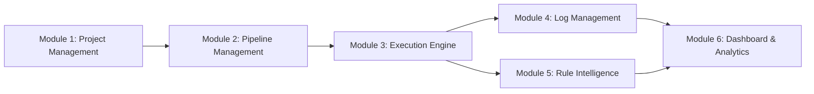

# DevOpsHub — System Overview

**Product:** DevOpsHub — Intelligent CI/CD Management Platform  
**Academic Context:** CSE1007 — Java Programming  

---

## 1. System Overview

DevOpsHub is an intelligent continuous integration and continuous deployment management desktop application. Designed to provide engineers with transparent insight into software delivery cycles, it bridges the gap between mechanical pipeline execution and actionable diagnostic understanding.

Traditional CI/CD engines report binary pass/fail outcomes, leaving developers to sift through thousands of noisy log lines. DevOpsHub ingests execution metadata, exit codes, and standard error streams, applying explainable Java rule-based intelligence to isolate the root cause and provide instant recovery guidance.

---

## 2. Core Operational Modules

### Module 1: Project & Repository Management
- Complete lifecycle management for software projects.
- Repository URL associations, branch targets, and technology categorization.
- Aggregated project delivery health metrics.

### Module 2: Pipeline Configuration & DAG Validation
- Visual composition of delivery stages: Checkout, Build, Test, Security, Package, Deploy.
- Topological dependency configuration supporting sequential flows and parallel forks.
- Rigorous Directed Acyclic Graph (DAG) cycle validation.

### Module 3: Multithreaded Execution Engine
- High-performance, thread-safe task orchestration using bounded Java thread pools.
- Concurrent subprocess management via `ProcessBuilder`.
- Cooperative thread interruption and child process tree termination on cancellation.

### Module 4: Bounded Log Streaming & Storage
- Real-time stdout and stderr log capture with sub-millisecond timestamps.
- Circular in-memory buffering preventing OutOfMemory errors on voluminous output.
- Bounded batch persistence to MySQL database.

### Module 5: Rule-Based Failure Intelligence
- Explainable pattern-matching engine diagnosing failure categories.
- Contextual recovery advice eliminating developer guesswork.
- Direct matching for assertion mismatches, compilation errors, dependency issues, and timeouts.

### Module 6: Live Operational Dashboard & Analytics
- Live KPI metrics computed directly from stored execution history.
- Visual charts tracking reliability rates and failure category distributions.
- Instant access to recent builds and historical audit logs.
