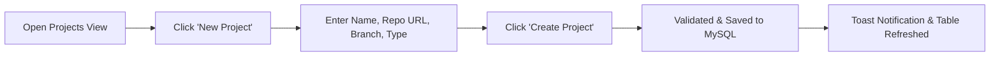

# DevOpsHub — Comprehensive Workflows Guide

This guide walks through each primary workflow supported by the DevOpsHub desktop application.

---

## Workflow 1: Creating a Project & Associating a Repository

1. Navigate to **Projects** via the left sidebar.
2. Click the blue **+ New Project** button in the header.
3. Fill in the required fields:
   - **Project Name:** Unique identifier (e.g., `Payment Gateway Service`).
   - **Repository URL:** Remote Git link (e.g., `https://github.com/vit/payments.git`).
   - **Default Branch:** Default target branch (e.g., `main`).
   - **Project Type:** Select `Java`, `Python`, or `NodeJS`.
4. Click **Create Project**.
5. Input is validated by `ProjectService`. Upon successful persistence to MySQL, a confirmation toast appears and the project table refreshes immediately.

---

## Workflow 2: Building & Configuring a Pipeline

1. Navigate to **Pipelines** in the sidebar and click **+ New Pipeline** (or click **Configure** on an existing pipeline).
2. Choose the parent project from the dropdown.
3. Choose the execution mode:
   - **SEQUENTIAL:** Stages run one after another in order.
   - **PARALLEL_FORK:** Stages configured with matching parallel group tags (e.g. `FORK_TEST`) execute simultaneously.
4. Add or reorder stages using the **Add Stage**, **Move Up**, and **Move Down** buttons:
   - Configure stage parameters: Command to execute, timeout in seconds, parallel group tag, and enabled status.
5. Click **Validate Pipeline** to test that stage dependencies form an acyclic graph.
6. Click **Save Pipeline** to persist the pipeline and its stages to MySQL.

---

## Workflow 3: Executing a Pipeline & Live Monitoring

1. In the **Pipelines** view, locate the desired pipeline and click **Run**.
2. DevOpsHub creates a new execution record with a sequential build number (e.g., `Build #185`) and transitions to the **Execution Details** view.
3. The top banner displays the live build state (`RUNNING`).
4. As each stage executes:
   - Its visual card turns amber (`RUNNING`) with a live status badge.
   - The dark console terminal displays stdout and stderr output in real time.
   - Upon completion, the card updates to emerald (`SUCCESS`) or rose (`FAILED`) and records elapsed duration.
5. If the user clicks **Cancel Run**, a cancellation signal gracefully terminates running subprocesses and marks the execution `CANCELLED`.

---

## Workflow 4: Investigating Failures & Reviewing Recommendations

1. When a stage process returns a non-zero exit code, execution halts and any remaining dependent stages are marked `SKIPPED`.
2. The **Failure Intelligence Engine** activates automatically:
   - Normalizes logs and matches error signatures against registered rules.
   - Pinpoints the root cause (e.g. HTTP 401 vs 500 status mismatch in `LoginService`).
3. An **Intelligent Failure Diagnosis** card appears on the screen:
   - **Category Tag:** Displays failure category badge (e.g. `ASSERTION_FAILURE`).
   - **Likely Cause:** Plain-English explanation of why the failure occurred.
   - **Evidence Excerpt:** Exact snippet extracted from execution logs.
   - **Recommended Next Action:** Specific remediation advice (e.g., *"Inspect LoginService error handling before rerun"*).
4. The engineer reviews the recommendation, corrects the source code, and triggers a clean re-run.
