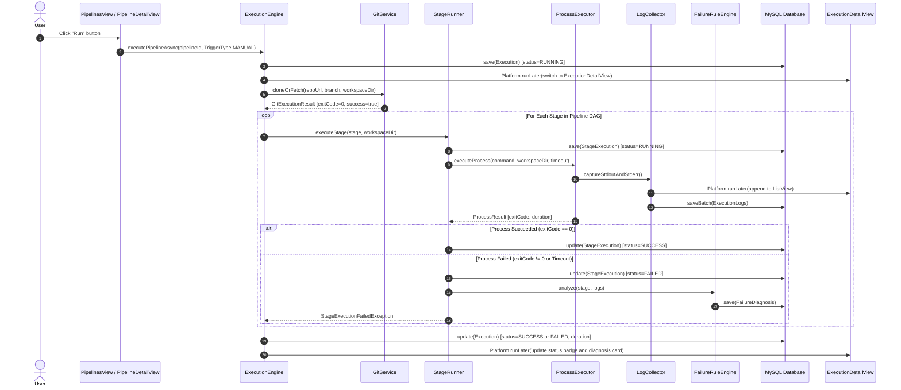
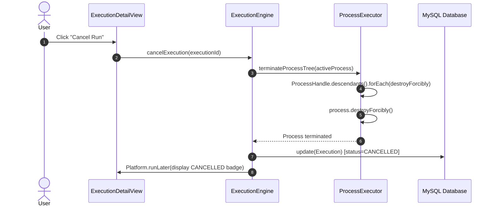
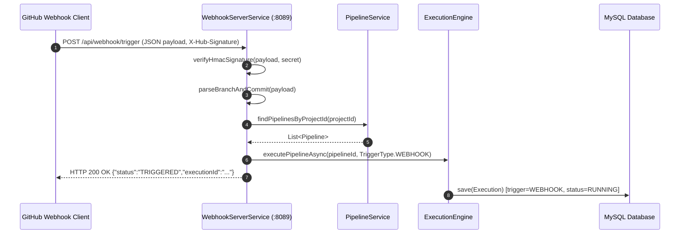

# DevOpsHub — Architecture & Call-Chain Audit

**Audit Date:** 2026-10-23  
**Auditor:** Principal Software Architect, Senior Java Engineer  

---

## 1. System Architecture Map

DevOpsHub is structured as a modular Java 21 desktop application featuring a reactive JavaFX front-end, an asynchronous multi-threaded execution engine, a rule-based failure intelligence analyzer, and a persistent MySQL 8 relational storage layer.

```mermaid
graph TD
    subgraph UI_Layer ["Presentation Layer (JavaFX)"]
        MLV[MainLayoutView]
        PV[ProjectsView]
        PDV[ProjectDetailView]
        PLV[PipelinesView]
        PBV[PipelineBuilderView]
        EHV[ExecutionHistoryView]
        EDV[ExecutionDetailView]
        LVV[LogViewerView]
        DV[DashboardView]
        SV[SettingsView]
    end

    subgraph Service_Layer ["Application & Domain Services"]
        PS[ProjectService]
        PLS[PipelineService]
        PIS[ProjectImportService]
        DS[DashboardService]
        GS[GitService]
        DPS[DeploymentService]
        PSS[PipelineSchedulerService]
        WSS[WebhookServerService]
    end

    subgraph Execution_Engine ["Execution & Process Orchestration"]
        EE[ExecutionEngine]
        ETP[ExecutionThreadPool]
        SR[StageRunner]
        PE[ProcessExecutor]
        LC[LogCollector]
        FRE[FailureRuleEngine]
    end

    subgraph Persistence_Layer ["Persistence & Database (MySQL 8)"]
        DM[DatabaseManager (HikariCP)]
        PR[ProjectRepository]
        PLR[PipelineRepository]
        ER[ExecutionRepository]
        LR[LogRepository]
        DR[DiagnosisRepository]
    end

    %% Wiring
    MLV --> PV & PLV & PBV & EHV & EDV & LVV & DV & SV
    PV --> PS & PIS
    PDV --> PS & PLS
    PLV --> PLS & EE
    PBV --> PLS & PS & EE
    EDV --> ER & LR & DR & EE
    SV --> ER & DM

    PS --> PR
    PLS --> PLR
    EE --> ETP & SR & GS & ER & LR & FRE
    SR --> PE & LC
    FRE --> DR
    WSS --> EE
    PSS --> EE

    PR & PLR & ER & LR & DR --> DM
```

---

## 2. Core Call-Chain Traces

### Workflow 1: Manual Pipeline Trigger & Execution



### Workflow 2: Execution Cancellation



### Workflow 3: Webhook Event Ingestion & Execution



---

## 3. Asynchronous Threading Model & Concurrency Boundaries

1. **JavaFX Application Thread (`Main Thread`):**
   - Handles all event dispatches, mouse clicks, layout calculations, and node mutations.
   - Absolutely zero blocking I/O, process execution, Git cloning, or database operations are executed on this thread.

2. **Pipeline Execution Pool (`DevOpsHub-Pipeline-*`):**
   - Initialized via `Executors.newFixedThreadPool(4, namedThreadFactory("DevOpsHub-Pipeline-"))`.
   - Maximum 4 concurrent pipelines can execute simultaneously.
   - Thread bounds prevent host resource exhaustion.

3. **Stage Execution Pool (`DevOpsHub-Stage-*`):**
   - Initialized via `Executors.newFixedThreadPool(16, namedThreadFactory("DevOpsHub-Stage-"))`.
   - Used for concurrent execution of parallel stages in `PARALLEL_FORK` pipelines.

4. **Webhook Server Daemon (`DevOpsHub-WebhookServer`):**
   - Runs in a background executor attached to the embedded HTTP server on port 8089.

5. **Scheduler Daemon (`DevOpsHub-Scheduler`):**
   - Dedicated single-thread scheduled executor checking cron trigger expressions every 5 seconds.

---

## 4. Architectural Integrity & Fault Tolerance

- **DAG Cycle Safety:** `PipelineValidator` applies Kahn's algorithm (`in-degree` reduction) to ensure no execution can begin if a circular dependency exists.
- **Fail-Fast Stage Sequencing:** If any prerequisite stage fails, downstream stages are immediately marked `SKIPPED` without running unvalidated commands.
- **Log Streaming Decoupling:** `LogCollector` collects lines asynchronously and writes to MySQL using batched JDBC transactions every 25 lines or 500ms, preventing database write contention.
