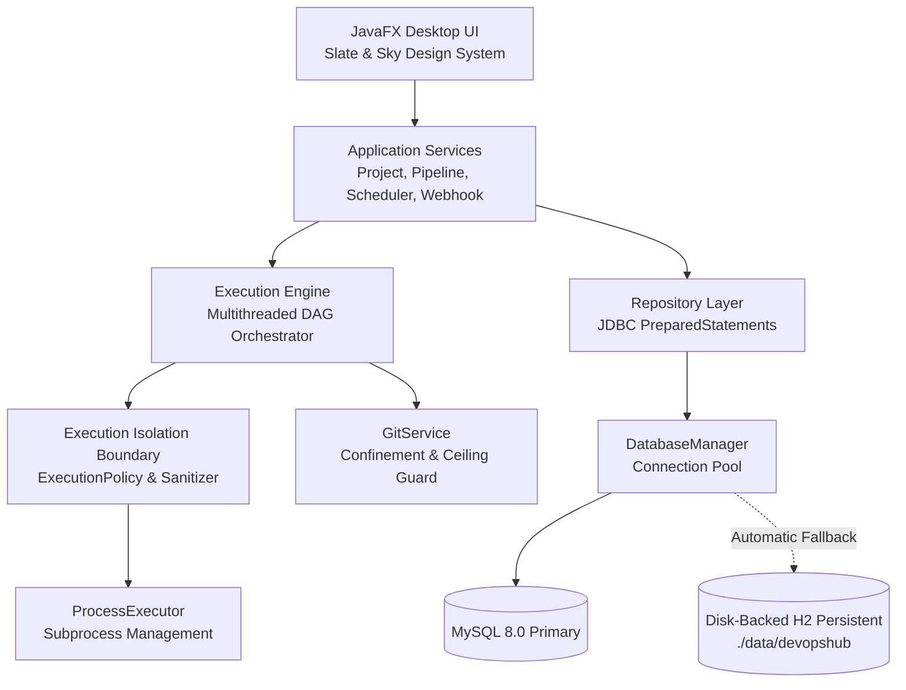
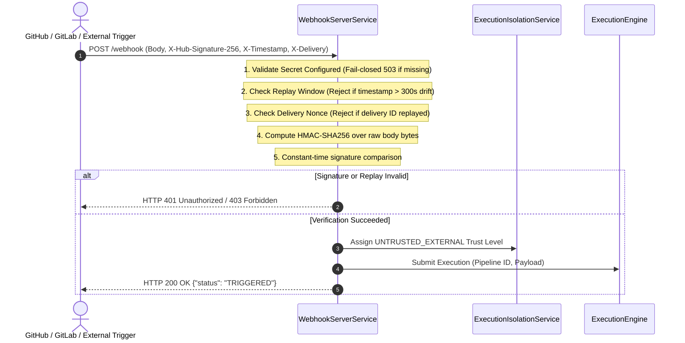
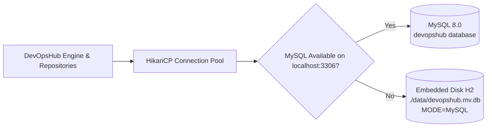
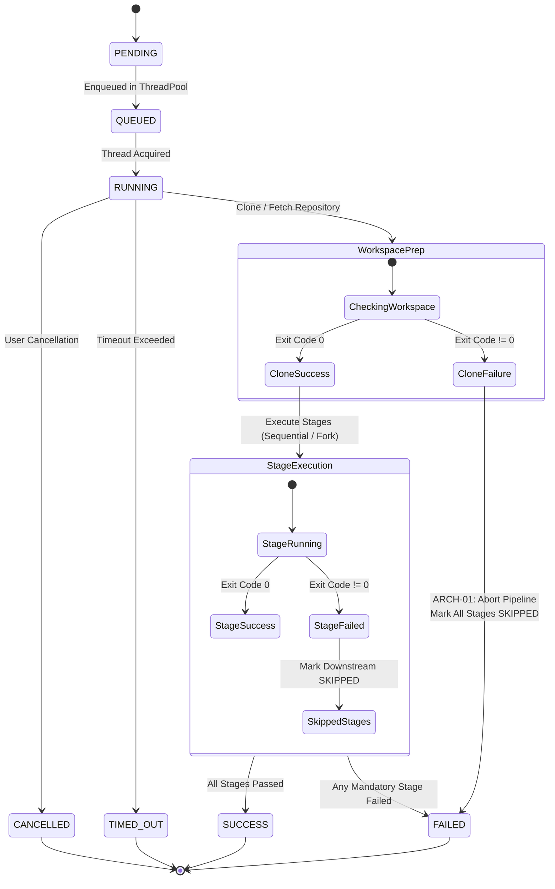

# DEVOPSHUB — REPAIRED SYSTEM ARCHITECTURE & DESIGN SPECIFICATION

**Document Version:** 1.0.0  
**Phase:** Engineering Recovery & Stabilization  
**Authors:** DevOpsHub Architecture & Security Engineering Team  

---

## 1. System Overview & Architectural Mission

DevOpsHub is an intelligent desktop CI/CD management application designed for software development teams and academic instruction (CSE1007). It combines a high-performance native JavaFX desktop client with a robust multithreaded execution engine, automated diagnostic rule engine, and dual-mode durable persistence.

Following a comprehensive recovery and stabilization mission, DevOpsHub's architecture has been systematically strengthened to eliminate security vulnerabilities, data-loss risks, and execution lifecycle anomalies.



---

## 2. Core Subsystems & Repaired Boundaries

### 2.1 Execution Boundary & Security Trust Model (SEC-01)

Historically, DevOpsHub executed arbitrary shell commands directly under the desktop user's account, inheriting all environment variables (including cloud keys, SSH auth sockets, and database passwords).

The repaired architecture introduces an explicit **Execution Boundary** governed by `ExecutionPolicy` and `ExecutionIsolationService`:

```
               Pipeline Trigger
             /                  \
   Manual / Local UI        Remote Webhook / API
          |                           |
  TRUSTED_LOCAL               UNTRUSTED_EXTERNAL
          |                           |
  Allow Host Exec              Requires Container Sandbox
  (Sanitized Env)                     |
          |                  [Docker Daemon Active?]
          |                 /                       \
          |               YES                        NO
          |                |                         |
          v                v                         v
   Host Subprocess    Container Runner         FAIL CLOSED
   (Sanitized Env)    (Isolated Cgroups)       Exit Code 126
                                               Status: FAILED
```

#### Key Guarantees:
1. **Environment Sanitization:** Subprocess environments are wiped clean (`env.clear()`) before injection. Sensitive variables matching patterns such as `AWS_*`, `GITHUB_*`, `SSH_*`, `DATABASE_*`, `DB_*`, `*TOKEN*`, `*KEY*`, and `*SECRET*` are strictly stripped.
2. **Directory Confinement:** Working directories are validated against unauthorized locations. Execution in the DevOpsHub application root repository (`.`) or the filesystem root (`/`) throws a `SecurityException`.
3. **Fail-Closed Policy for Untrusted Workloads:** Remote webhooks and externally supplied repositories are classified as `UNTRUSTED_EXTERNAL`. When a genuine container sandbox (e.g., Docker container runner) is unavailable on the host, untrusted executions fail closed with POSIX exit code `126`, preventing unauthorized code execution on the desktop.

---

### 2.2 Webhook Authentication & Replay Protection (SEC-02)

The webhook subsystem (`WebhookServerService`) has been upgraded to enterprise-grade cryptographic authentication:



#### Cryptographic Standards:
- **HMAC-SHA256:** Computed via `javax.crypto.Mac` using standard SHA-256.
- **Timing Attack Defense:** Signatures are compared via `MessageDigest.isEqual()`, ensuring constant-time evaluation.
- **Zero-Downtime Secret Rotation:** Supports primary `WEBHOOK_SECRET_KEY` and secondary `WEBHOOK_ROTATION_SECRET_KEY`.
- **Replay Protection:** Rejects payloads with timestamps older than 300 seconds (`REPLAY_WINDOW_MILLIS`) and drops duplicate delivery IDs using a concurrent LRU cache.

---

### 2.3 Git Workspace Management & Attribution Isolation (SEC-03, ARCH-02)

`GitService` orchestrates repository cloning, branch switching, commit resolution, and directory cleanup.

#### Confinement & Preservation (SEC-03):
- Destination directories are strictly canonicalized and validated against `baseWorkspaceDir` (`./workspaces`). Path traversal attacks (`../../`) and cloning into the application root are rejected with `DevOpsHubException`.
- **Ownership Tracking:** `GitService.cloneOrFetch` checks if `destinationDir.exists()` prior to cloning. If cloning fails, directory deletion occurs **only if** `createdByThisOperation == true`. Pre-existing user directories are preserved intact.
- **Symlink-Safe Deletion:** `safeCleanupDirectory` traverses directory trees using `Files.walkFileTree` without following symlinks. When a symlink is encountered, `Files.delete()` unlinks the symlink itself without entering external target directories.

#### Commit Attribution Isolation (ARCH-02):
- Git commands traversing up the directory hierarchy can inadvertently discover the host repository `.git` directory when subdirectories lack their own repository metadata.
- **Immediate Git Guard:** `isImmediateGitRepository(repoDir)` verifies `new File(repoDir, ".git").exists()` before running `rev-parse`, `log`, `diff`, or `status`. If `.git` is absent, `"UNKNOWN"` is returned immediately.
- **Ceiling Directories:** The Git process environment sets `GIT_CEILING_DIRECTORIES` to the parent of `baseWorkspaceDir`, blocking Git CLI upward traversal.

---

### 2.4 Durable Persistence Model (DAT-01)

DevOpsHub employs a dual-mode persistence architecture managed by `DatabaseManager`:

| Persistence Mode | Underlying Engine | Durability | Use Case |
|---|---|:---:|---|
| **Primary** | MySQL 8.0 via `HikariCP` | Full Disk Durability | Production and multi-developer environments |
| **Persistent Fallback** | Embedded H2 (`jdbc:h2:file:./data/devopshub`) | Full Disk Durability across JVM restarts | Standalone desktop usage when MySQL is not installed or running |
| **Ephemeral Test** | In-Memory H2 (`H2_IN_MEMORY_ONLY=true`) | Memory-Only | Isolated automated test suites |



- When falling back to H2, MySQL compatibility mode (`MODE=MySQL`) is enforced to ensure schema and query compatibility.
- Backup utilities (`DatabaseManager.backupDatabase`) allow exporting disk snapshots to `.zip` archives.

---

### 2.5 Pipeline Lifecycle State Machine & Correctness (ARCH-01, ARCH-03)

The pipeline lifecycle follows a strict deterministic state machine:



#### Terminal State Guard (ARCH-03):
`Execution.setStatus` and `StageExecution.setStatus` enforce state immutability once a terminal state (`SUCCESS`, `FAILED`, `CANCELLED`, `SKIPPED`) is reached. Asynchronous or late completion callbacks from worker threads cannot overwrite a terminal state.

---

### 2.6 User Interface Architecture & MVP Workflows (UI-01, UI-02, UI-03)

The UI layer is built on JavaFX 21 following Model-View-Presenter / Reactive principles:

- **Global Navigation & Search (UI-02):** `MainLayoutView` coordinates screen transitions and routes queries from the top header search field to the active view (`ProjectsView`, `PipelinesView`, `ExecutionHistoryView`, `LogViewerView`).
- **Pipeline Scheduling Dialog (UI-01):** `PipelineDetailView` provides an interactive scheduling modal allowing users to configure cron or fixed-interval schedules (5m to 24h) via `PipelineSchedulerService`. Active jobs are displayed with manual trigger and unschedule controls in `SettingsView`.
- **Real-Time Execution Logs (ARCH-04):** `LogViewerView` consumes stream events from `BoundedLogBuffer`, which caps memory usage at 1,000 lines per buffer and emits notifications when capacity is reached while durable logs remain in the database.

---

## 3. Security Boundary Summary

| Threat / Risk | Mitigating Component | Protection Level |
|---|---|---|
| Malicious script accessing host secrets | `ExecutionPolicy.sanitizeEnvironment()` | **High:** Host AWS, GitHub, SSH, and DB credentials scrubbed |
| Directory escape (`../../`) in workspace | `GitService.validateWorkspaceConfinement()` | **High:** Paths validated against canonical workspace root |
| Destructive deletion of user files on clone failure | `GitService.cloneOrFetch()` ownership tracking | **High:** Pre-existing directories strictly preserved |
| Symlink escape during workspace cleanup | `GitService.safeCleanupDirectory()` | **High:** Walk does not follow symlinks; deletes link only |
| Host repository commit leakage | `isImmediateGitRepository` + `GIT_CEILING_DIRECTORIES` | **High:** Returns `"UNKNOWN"`, ceiling blocks upward traversal |
| Remote webhook forgery / tampering | `WebhookServerService` HMAC-SHA256 | **High:** Constant-time verification against raw body |
| Webhook replay attack | `WebhookServerService` timestamp + delivery cache | **High:** Rejects drift > 300s or duplicate nonces |
| Subprocess host takeover from untrusted repo | `ExecutionTrustLevel.UNTRUSTED_EXTERNAL` | **Fail-Closed:** Rejected with code 126 unless containerized |

---

## 4. Architectural Limitations & Roadmap

1. **Host-Level Container Sandboxing:** True OS-level virtualization (cgroups/namespaces) requires a running container daemon (Docker / Podman). On environments without Docker, untrusted external workloads fail closed rather than running insecurely on the host.
2. **H2 Process Concurrency:** File-backed embedded H2 is configured with `;AUTO_SERVER=TRUE` to allow automatic mixed-mode server negotiation among local processes. For high concurrency or multi-user network deployments, MySQL or an external database server is recommended.
3. **Desktop Process Lifecycle for Scheduler:** Schedulers operate within the JVM process. When DevOpsHub desktop is closed, background scheduling stops until the user re-launches the application.
